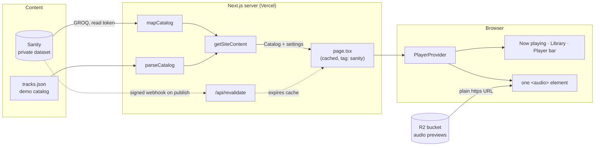

# W.I.L.L.I.A.M.S Beats

> A one-page site for my beats, built around a record player. Pick a beat and the needle drops: the record spins while it plays and the tonearm follows the playback position.

**Live:** [music.btalu.ca](https://music.btalu.ca)

[](package.json)
[](package.json)
[](tsconfig.json)
[](package.json)
[](sanity.config.ts)
[](#r2)
[](#vercel)
[](LICENSE)
[](LICENSE)

---

## Quick start

<details>
<summary><strong> About the app</strong></summary>

The page has three parts:

- **Now playing** (left): a record and tonearm drawn over the current beat's cover art. The record spins only while audio is actually playing (not while loading or buffering), and the tonearm moves with the playback position. Beats without a cover sit on a plain grey backdrop.
- **Library** (right): every beat with its genre, BPM, key and length, filtered by genre tabs. A tab only appears when at least one beat has that genre. The current beat shows a progress ring and moving EQ bars.
- **Player bar** (bottom): previous, play/pause, next, seek, shuffle, repeat (off / all / one), mute and volume.

On mobile the panels stack and the library becomes a sheet you tap or swipe open.

Also:

- **Keyboard:** `Space` play/pause · `←` `→` seek 5 s · `Shift` + `←` `→` previous/next · `↑` `↓` volume · `M` mute · `S` shuffle · `R` repeat
- **Lock screen and headphone controls** through the Media Session API
- **Remembers** volume, mute and repeat in the browser. Beats of 5 minutes or longer pick up where you left off.

</details>

<details>
<summary><strong> Content: demo or Sanity</strong></summary>

- **Demo mode** (no environment variables): the catalog comes from `src/data/tracks.json`, and `npm run dev` / `npm run build` generate 30-second placeholder beats in `public/audio/` (git-ignored).
- **Sanity mode** (Sanity variables set): beats and page text come from Sanity, and the placeholders are skipped. See [Sanity](#sanity).

A production deploy on Vercel refuses to serve the demo catalog unless `ALLOW_DEMO_CONTENT=true` is set, so the live site can't silently fall back to placeholder beats.

</details>

<details>
<summary><strong> How to install and run</strong></summary>

```bash
npm install
npm run dev
```

Production build:

```bash
npm run build
npm start
```

To run against Sanity locally, use `npm run dev:secrets`: it injects the environment variables from Infisical, so no secrets live in `.env` files. `.env.example` lists the variable names only.

</details>

<details>
<summary><strong> Scripts and commands to run</strong></summary>

| Command | What it does |
|---|---|
| `npm run dev` | Placeholder audio (demo mode only), then the dev server |
| `npm run build` / `npm start` | Placeholder audio (demo mode only), production build, then serve it |
| `npm run dev:secrets` / `npm run build:secrets` | Same, with environment variables injected by Infisical |
| `npm test` / `npm run test:watch` | Unit tests: player reducer, catalog, Sanity mapping, webhook |
| `npm run typecheck` | TypeScript, including the generated Sanity query types |
| `npm run typegen` | Regenerate Sanity types after a schema or query change |
| `npm run check:secrets` | After a build, confirm no tokens ended up in the browser bundle |

</details>

## Sanity

Sanity is the CMS: it holds every beat and the page text, so I can publish a beat without touching code. The site only reads from it, nothing on the public page can write to it. It's also how I'm learning a headless CMS as part of this portfolio project.

<details>
<summary><strong> Why Sanity (and not Contentful)</strong></summary>

Sanity and Contentful were the two candidates. I chose Sanity because:

- **The content model is code.** Schemas are TypeScript files in this repo (`beat.ts`, `siteSettings.ts`…), so changes to the content model are versioned and reviewed in PRs like everything else.
- **Studio is a React app I own.** It's embedded at `/studio` on my own site and can be customised: the singleton Site settings, the genre dropdown, the label-colour field, the cover field.
- **Typed queries end to end.** GROQ plus TypeGen generates TypeScript types from the schema and the query, so if the query and the mapper disagree, `npm run typecheck` fails before anything ships.

What that choice meant:

1. **Audio stays out of Sanity.** Its free bandwidth is too small for audio (roughly 10 GB a month when I checked), so the files live on [R2](#r2) and Sanity only stores their URLs.
2. **More to learn than with a simpler tool.** GROQ, TypeGen and webhooks are extra concepts, but learning them is part of the goal.
3. **The free plan fits.** Contentful's free plan doesn't allow commercial use, which matters once beats are licensed; Sanity's free plan works for now.

The choice isn't locked in, though. The `Catalog` type (`src/lib/catalog.ts`) isolates Sanity from the rest of the app: only `src/sanity/mapCatalog.ts` knows Sanity's shape. Switching CMS later would mean rewriting that one file plus the schemas, not the player or the UI.

</details>

<details>
<summary><strong> What's stored</strong></summary>

| Document | What it holds | Used on the page |
|---|---|---|
| **Beat** | Title, slug (the beat's permanent ID), preview audio (URL, R2 object key, duration), genre, BPM, musical key, cover art, label colour, release date | Yes: the library, the player and the record |
| **Site settings** (one fixed document) | Artist name, tagline, contact email, links, about text, mailing address | Name, tagline, email and links. Empty fields fall back to `src/config/site.ts` |
| **Playlist** | A name and a list of beats | Not yet. Kept for grouping beats into releases later |

A few rules are built into the schema:

- The preview audio URL must be on my audio domain (`NEXT_PUBLIC_AUDIO_BASE_URL`), so a beat can't point anywhere else.
- Audio, R2 key and duration are read-only in Studio: they come from the upload, not from typing.
- Genres and musical keys are fixed dropdowns, and a genre tab only shows on the site once a beat uses it.
- Beats are sorted newest first by release date.
- Previews only, never masters.

</details>

<details>
<summary><strong> Studio</strong></summary>

Sanity Studio is embedded in the site at **`/studio`**, so content is edited on the same domain (sign-in is through Sanity). Without a project ID it shows a "Sanity isn't configured" page instead of crashing.

- **Site settings** sits at the top and can't be duplicated or deleted.
- **Beats** list with a warning on any beat that has no audio.
- **Vision** for testing GROQ queries.

</details>

<details>
<summary><strong> How the site reads it</strong></summary>

- There are two datasets, both **private**: `production` for the live site, and `staging` for dev and preview deployments (with test beats).
- One GROQ query (`src/sanity/queries.ts`) fetches settings and beats in a single request.
- Because the datasets are private, the site reads them with a Viewer token on the server only (`src/sanity/client.ts` is `server-only`). Only **published** documents are returned; drafts never reach the page.
- `src/sanity/mapCatalog.ts` turns the result into the same `Catalog` shape the demo uses, so the components never know which source is active.
- The page is cached. When I publish, a **signed webhook** calls `/api/revalidate`, which checks the signature and expires the cache so the next visit gets fresh content. Only beat, playlist and site settings changes count.
- The API version is pinned (`2026-10-01`) so Sanity changes can't break the site unexpectedly.

</details>

<details>
<summary><strong> Environment variables</strong></summary>

| Variable | Where | Notes |
|---|---|---|
| `NEXT_PUBLIC_SANITY_PROJECT_ID` | Infisical + Vercel | Public. Setting it switches the site from demo to Sanity mode |
| `NEXT_PUBLIC_SANITY_DATASET` | Infisical + Vercel | Public. `production` in prod, `staging` in dev and staging. Defaults to `production` |
| `SANITY_API_READ_TOKEN` | Infisical + Vercel | **Secret**, Viewer role, server only. A separate token per environment, so one can be revoked without breaking the others |
| `SANITY_REVALIDATE_SECRET` | Infisical + Vercel (prod) | **Secret**. Must match the Sanity webhook's secret |
| `SANITY_API_WRITE_TOKEN` | Infisical `/local` only | **Secret**, Editor role. Only for my upload script; never synced to Vercel |

</details>

<details>
<summary><strong> Changing the schema</strong></summary>

Schemas live in `src/sanity/schemaTypes/`. After changing a schema or the query:

```bash
npm run typegen     # regenerates sanity.schema.json and src/sanity/sanity.types.ts
npm run typecheck   # fails if the query and mapCatalog.ts no longer agree
```

Never edit the generated files by hand.

</details>

## R2

Cloudflare R2 stores the audio. Sanity only keeps each beat's audio URL, R2 object key and duration; the files themselves never go through Sanity or this repo.

<details>
<summary><strong> Why R2</strong></summary>

- **Audio is the heaviest thing on the site**, and Sanity's free bandwidth is far too small for it.
- **No egress fees.** R2 doesn't charge for downloads, so costs don't grow with listening.
- **The site needs no R2 keys.** The player just loads plain `https://` URLs into the `<audio>` element; no code in `src/` talks to the R2 API. Only my upload workflow does.

</details>

<details>
<summary><strong> Buckets</strong></summary>

| Bucket | Holds | Serves | Infisical envs | Sanity dataset |
|---|---|---|---|---|
| **Staging** | Sample audio files | The site in dev and staging | `dev`, `staging` | `staging` |
| **Production** | Real beat previews | The live site only | `prod` | `production` |

Test uploads, replacements and deletes happen in staging, so they can never break a beat the live site is playing.

Both buckets are set up the same way:

- **Custom domain** on a subdomain of my domain (`NEXT_PUBLIC_AUDIO_BASE_URL`), separate from the website's own subdomain. The default `r2.dev` public URL is off.
- **CORS:** `GET` and `HEAD` with range requests from the site origins that bucket serves (the live site for production; Vercel previews for staging; `localhost` for both), so the player can stream and seek.
- **Hotlink protection:** a Cloudflare WAF rule blocks requests whose `Referer` is set but isn't my site, `localhost` or my Vercel previews. An empty `Referer` is allowed on purpose, since some browsers strip it. It's a deterrent against embedding, not a lock, which is why only tagged previews are public.
- **API token per bucket**, scoped to that bucket only (Object Read & Write), so a leaked staging key can't touch production audio.
- Studio rejects any beat whose audio URL isn't on that environment's domain, so the `production` dataset can't be copied into `staging` as-is.
- Previews only, never masters.

</details>

<details>
<summary><strong> How I add a beat</strong></summary>

This is my own workflow. The upload script and its helpers live only on my machine and aren't part of this repo.

1. **Tag the preview** (MP3 or M4A, under 25 MB) with title, genre, BPM, key and cover art, so there's less to fill in later.
2. **Run the upload script** through Infisical, choosing the environment: `staging` for test beats, `prod` for real ones. It takes one file or a whole folder and, for each beat:
   - reads the duration and tags. The title comes from the tag or the file name, and the genre, BPM and key are matched to the Studio dropdowns (common spellings like "lofi", "Afrobeats" or "RnB" are recognised)
   - uploads the audio to that environment's bucket under a content-hashed name with a one-year immutable cache, skipping it if the same file is already there
   - uploads embedded cover art to Sanity
   - creates a **draft** beat with the audio URL, R2 key and duration, a random label colour, and the file's date as the release date, so a batch keeps the order I made the beats in
   - fills only empty fields on a re-run, so anything I edited in Studio is kept

   A `--dry-run` shows what it would read without uploading anything, and `--publish` publishes straight away instead of making drafts (handy for test beats). One failing file is reported and the rest carry on.
3. **Finish it in Studio:** check genre, BPM and key, add a cover if the file had none. The audio fields are read-only there.
4. **Publish.** In production, the webhook refreshes the live site within seconds.

**Replacing audio** is the same upload with the new file: it gets a new hashed name, so the change shows up straight away. **Removing a beat** is unpublishing or deleting it in Studio; the file stays in R2 until I delete it.

If an audio file is ever missing, the player shows "Can't play" and, if there's another beat in the queue, skips to it.

</details>

<details>
<summary><strong> Environment variables</strong></summary>

| Variable | Where | Notes |
|---|---|---|
| `NEXT_PUBLIC_AUDIO_BASE_URL` | Infisical + Vercel | Public. The audio domain for that environment's bucket |
| `R2_ACCOUNT_ID`, `R2_ACCESS_KEY_ID`, `R2_SECRET_ACCESS_KEY`, `R2_BUCKET` | Infisical `/local` only | **Secret** (except the bucket name). Upload script only; never synced to Vercel |

</details>

## Vercel

Vercel hosts the live site at [music.btalu.ca](https://music.btalu.ca).

<details>
<summary><strong> How it deploys</strong></summary>

- **Every branch I push** gets a preview deployment. Previews sit behind Vercel Authentication, so only I can open them.
- **Merging to `main`** deploys to production.
- **Rolling back** is promoting the last good deployment to production in Vercel.
- A production build that can't reach Sanity fails, and Vercel keeps the last good deploy live.

</details>

<details>
<summary><strong> Environments and secrets (Infisical)</strong></summary>

Every token, secret and API key for Sanity, R2 and Vercel lives in **Infisical**, the single source of truth. Nothing secret is typed into Vercel or stored in a file.

| Infisical env | Runs as | Sanity dataset | Audio bucket |
|---|---|---|---|
| `dev` | `npm run dev:secrets` on my machine | `staging` | Staging |
| `staging` | Vercel **Preview** deployments | `staging` | Staging |
| `prod` | Vercel **Production** | `production` | Production |

- **Secret Syncs** push the `/` folder of `prod` to Vercel Production and of `staging` to Vercel Preview. The app still just reads `process.env`, so no code depends on Infisical.
- **Tool-only secrets** (Sanity write token, R2 keys) live in a `/local` folder that is **never synced**, so the deployed site has no write access to Sanity or R2.
- **On my machine**, `infisical run` injects secrets into that one process only. `.infisical.json` is committed; it holds only the project ID.
- **Rotating a token:** create the new one, replace it in Infisical (auto-sync updates Vercel), redeploy (Vercel only applies env changes to new deployments), then delete the old one.

</details>

<details>
<summary><strong> Domain</strong></summary>

- Cloudflare stays in charge of my domain's DNS. The site's subdomain is a CNAME to Vercel set to **DNS only** (grey cloud), so Vercel issues HTTPS.
- The domain's nameservers are never moved to Vercel: that would break the R2 audio domains and the WAF rule.

</details>

<details>
<summary><strong> Production guard (<code>ALLOW_DEMO_CONTENT</code>)</strong></summary>

On Vercel production (`VERCEL_ENV=production`), the build refuses to use the demo catalog: if Sanity isn't configured it fails with "Production deploy without Sanity" instead of shipping placeholder beats. `ALLOW_DEMO_CONTENT=true` overrides that on purpose, for going live before Sanity is set up. Once Sanity is configured the flag has no effect and can be removed.

</details>

<details>
<summary><strong> Sanity webhook</strong></summary>

Publishing in Studio refreshes the live site through a Sanity webhook on the `production` dataset (create, update and delete, projection `{_type}`) to `POST /api/revalidate`:

- The request must carry a valid signature made with `SANITY_REVALIDATE_SECRET`; a missing or wrong one gets `401`.
- Only `beat`, `playlist` and `siteSettings` changes expire the cache (`src/lib/revalidateHandler.ts`); other types get `400`. The webhook's filter in Sanity should match that list.
- The cache is expired immediately, so the next visit rebuilds the page with fresh content.

Sanity's CORS origins list the live site, my Vercel preview URLs and `localhost`. That's only needed for `/studio`; the site itself reads Sanity on the server.

</details>

<details>
<summary><strong> Before every deploy</strong></summary>

```bash
npm run typecheck
npm test
npm run build
npm run check:secrets   # fails if a token or secret ended up in what browsers download
```

</details>

<details>
<summary><strong> When something breaks</strong></summary>

| Symptom | Likely cause |
|---|---|
| Build fails: "Production deploy without Sanity" | The Sanity variables aren't reaching that environment from Infisical |
| Build fails: "SANITY_API_READ_TOKEN is missing" | The project ID is set but the read token isn't |
| `/studio` shows "Sanity isn't configured" | `NEXT_PUBLIC_SANITY_PROJECT_ID` isn't set in that environment |
| Published a beat but the site didn't change | Webhook URL, filter or secret doesn't match `SANITY_REVALIDATE_SECRET` |
| A beat is in Studio but not on the site | It's still a draft, or it has no audio URL (the query skips both) |
| `check:secrets` fails | A token was read in client code or put in a `NEXT_PUBLIC_*` variable |
| Changed a secret in Infisical, site still uses the old one | Vercel only applies env changes to new deployments: redeploy |
| Domain stuck on "Invalid configuration" | CNAME target typo, or the record is proxied (orange cloud) |
| Redirect loop | Cloudflare proxy on with SSL mode "Flexible": switch the record to DNS only |
| Audio won't play on a preview | That bucket's CORS or the WAF rule doesn't allow the preview's origin |

</details>

## Architecture design

One page (`/`), prerendered on the server and cached, plus the embedded Studio at `/studio` and one API route for the webhook. All playback runs in the browser.



<details>
<summary><strong> Content: one boundary</strong></summary>

- `getSiteContent()` (`src/lib/getSiteContent.ts`, server-only) picks the source: Sanity when a project ID is set, otherwise the demo catalog. On Vercel production it refuses the demo unless `ALLOW_DEMO_CONTENT=true`.
- Both sources end up as the same **`Catalog`** type (`src/lib/catalog.ts`). Sanity goes through `mapCatalog.ts`, the only code that knows Sanity's shape; the demo goes through `parseCatalog`, which fails the build on a typo in `tracks.json`.
- Components never know which source is active. They get the catalog through the player and the page text (`SiteSettings`) as props.
- The catalog seeds the player's state on the server, so the beat list is already in the HTML before any JavaScript runs.

</details>

<details>
<summary><strong> Player: state, engine and controls</strong></summary>

Three pieces, each with one job:

| Piece | File | Job |
|---|---|---|
| **Reducer** | `src/lib/playerReducer.ts` | Every playback state change. **Pure**: no randomness, no I/O, no clock. Anything impure (like a shuffle order) is computed first and passed in the action |
| **Engine** | `src/hooks/useAudioEngine.ts` | Owns the single `HTMLAudioElement`. Turns media events into actions, and the listener's intent into `play()` / `pause()` |
| **Context** | `src/context/PlayerContext.tsx` | Wires them together and defines every control (`playTrack`, `next`, `seek`, `toggleShuffle`…). Components read state with `usePlayer()` and never touch the `<audio>` element |

Key ideas:

- **Intent vs status.** `intent` is what the listener asked for (play or pause); `status` is what the audio element reports (`loading`, `buffering`, `playing`, `paused`, `ended`, `error`). Keeping them apart lets the UI show "wants to play, but buffering" with a spinner, instead of a play button that lies.
- **The record spins only when `status === "playing"`**, and the tonearm angle comes from `currentTime / duration`, so the turntable always reflects real playback.
- **`loadSeq`** goes up on every (re)load, so the engine can restart the same beat.
- **Errors:** a beat that can't play shows "Can't play" and, if there's more in the queue, the engine skips to the next one.
- Around the core: `useKeyboardShortcuts`, `useMediaSession` (lock screen and headphones), `useSheetDrag` (the mobile library sheet), and `src/lib/storage.ts`, which saves only listener settings (volume, mute, repeat, resume positions) to `localStorage`, throttled and flushed when the page is hidden.

</details>

<details>
<summary><strong> Caching and freshness</strong></summary>

- The page fetches Sanity with the cache tag `sanity` (no cache in development).
- Publishing in Studio fires the signed webhook; `/api/revalidate` verifies it and expires the tag, so the next visit rebuilds the page with the new content.
- The route stays thin: its logic is in `src/lib/revalidateHandler.ts`, where it can be tested without Next's cache.

</details>

<details>
<summary><strong> Secrets boundary</strong></summary>

- Modules that read a token start with `import "server-only"`, so importing them from a client component fails the build.
- `NEXT_PUBLIC_*` variables hold only public values (project ID, dataset, audio domain).
- The deployed site holds **read-only** access to Sanity and **no** R2 keys; write access exists only in my local upload workflow.
- `npm run check:secrets` scans what browsers download after a build and fails if a secret's value or a Sanity token pattern shows up.

</details>

<details>
<summary><strong> Studio isolation</strong></summary>

The root layout is bare on purpose. Site styles and fonts live in the `(site)` route group's layout, so they never leak into `/studio`, and Studio's code is split into its own route so it doesn't add weight to the main page.

</details>

<details>
<summary><strong> Project layout</strong></summary>

```text
src/
  app/
    (site)/            the page, its layout and CSS tokens
    studio/            embedded Sanity Studio
    api/revalidate/    Sanity webhook (thin route)
  components/          presentation only: read state via usePlayer()
  context/             PlayerContext: reducer + engine + controls
  hooks/               audio engine, media session, keyboard, sheet drag
  lib/                 reducer, Catalog type, content source, storage, webhook logic
  sanity/              schemas, query, client, mapper, generated types
  config/site.ts       page text fallback when Sanity leaves a field empty
  data/tracks.json     demo catalog
scripts/               placeholder audio, bundle secret check
tests/                 Vitest suites
```

</details>

<details>
<summary><strong> Tests</strong></summary>

Vitest covers the pure parts directly: the player reducer, catalog parsing, genre filters, the Sanity mapper, and the webhook handler (valid, missing and wrong signatures; ignored document types). Run with `npm test`.

</details>
